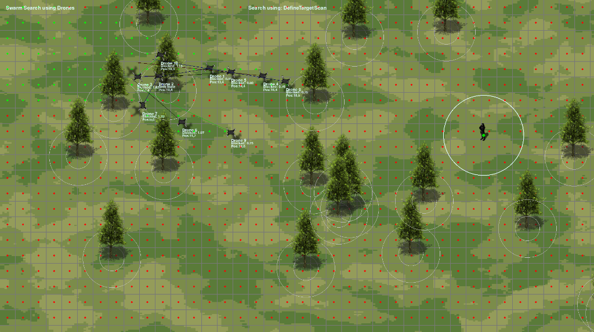

# 🚁 Drone Swarm Simulator

A robust, open-source framework for simulating drone swarms in search-and-rescue operations and target acquisition scenarios. This simulator provides researchers, developers, and robotics enthusiasts with a flexible platform to experiment with various swarm coordination strategies, decision-making algorithms, and search patterns.




## 🎯 Features

- Realistic drone movement patterns
- Configurable search environments with obstacles
- Pre-implemented search strategies (Row Scan, etc.)
- State machine-based decision logic for autonomous drone behavior
- **Optimized Collision Detection** using Quadtree spatial partitioning
- **Interactive Visualization** with Zoom and Pan capabilities
- Extensible architecture for implementing custom algorithms

## 📋 Requirements

- **Python 3.8+** (latest stable version recommended)
- **IDE/Editor** (VS Code or any preferred code editor)

## 🔧 Installation

### Dependencies

Install all required dependencies with a single command:

```bash
pip install -r requirements.txt
```

Or install individual components:

- **Pygame** - For rendering and simulation visualization
  ```bash
  pip install pygame
  ```

- **NumPy** - For efficient numerical computations
  ```bash
  pip install numpy
  ```

- **matplotlib** - For plots and visualizations
  ```bash
  pip install matplotlib
  ```


## 🚀 Getting Started

1. Clone the repository:
   ```bash
   git clone https://github.com/luizgiacomossi/Search_Drone_Swarms.git
   cd Search_Drone_Swarms
   ```

2. Run the simulator:
   ```bash
   python main.py
   ```

## 🏗️ Project Structure

```
Search_Drone_Swarms/
│
├── 📄 main.py               # Entry point and main simulation loop
├── 📄 constants.py          # Simulation parameters and configuration
├── 📄 utils.py              # Helper functions and utilities
│
├── 📄 vehicle.py            # Drone physics and movement controllers
├── 📄 state_machine.py      # Decision-making logic for drones
├── 📄 scan.py               # Search algorithms and patterns (Strategies)
├── 📄 grid.py               # Discrete environment representation
├── 📄 obstacle.py           # Environmental obstacle generation
│
├── 📄 swarm_manager.py      # Manages drone list, updates, and physics
├── 📄 display_manager.py    # Handles visualization, zoom, and pan
├── 📄 experiment_manager.py # Manages simulation stats and experiments
├── 📄 quadtree.py           # Spatial partitioning for optimization
│
├── 📁 model/                # Visual assets and drone sprites
├── 📁 assets/               # Screenshots and other assets
├── 📁 examples/             # Example scenarios and configurations
└── 📄 requirements.txt      # Project dependencies
```

## 🎮 Controls & Interface

- **Space:** Pause/Resume simulation
- **R:** Reset simulation
- **+/-:** Adjust simulation speed
- **ESC:** Exit simulator
- **Mouse Scroll:** Zoom In/Out
- **Mouse Click:** Place target/obstacle

## 🔍 Search Strategies

The simulator includes several pre-implemented search strategies:

- **Grid Search** - Systematic coverage of the entire area
- **Spiral Search** - Outward spiraling pattern from central point -> Not implemented yet
- **Random Walk** - Stochastic movement with collision avoidance -> Not implemented yet
- **Levy Flight** - Bio-inspired search pattern with occasional long jumps -> Not implemented yet

## ⚡ Performance & Optimization Benchmarks

The simulation loop has been profiled with `cProfile` and optimized to achieve maximum throughput and frame stability across large ($3840 \times 2160$) environments:

- **RLE-Accelerated Grid Rendering:** Switched the transparent grid overlay from CPU-heavy per-pixel alpha blending to colorkey with `RLEACCEL`, accelerating grid blits by over 6x.
- **Sprite Rotation Caching:** Pre-caches rotated drone sprites across integer angles to eliminate repetitive runtime `pygame.transform.rotozoom` operations.
- **Direct Obstacle Blitting:** Streamlined obstacle rendering to eliminate redundant sprite group updates and draws per frame.
- **Native Vector Operations:** Replaced heavy `copy.deepcopy` calls with native `pygame.math.Vector2` copies across the core steering, physics, and state machine paths (~74,000 deepcopies eliminated).
- **Cached Font Rendering:** Introduced a text surface lookup cache in `SwarmManager` to avoid redundant string rasterization.

### Optimization Results (600 Unthrottled Benchmark Frames)

| Metric | Before Optimization | After Optimization | Improvement |
| :--- | :--- | :--- | :--- |
| **Total Processing Time** | **4.90 s** | **3.17 s** | **~35% faster** |
| **Total Function Calls** | 2,121,610 | 1,234,195 | **~900,000 fewer calls** |
| **Grid Draw Time (`grid.py:draw`)** | 2.14 s | 0.34 s | **6.3x faster** |
| **Sprite Rotation (`rotozoom`)** | 0.66 s | 0.08 s | **8.2x faster** |
| **Swarm Update (`swarm_manager.update`)** | 1.11 s | 0.38 s | **2.9x faster** |

## 🔧 Configuration

Edit `constants.py` to modify simulation parameters:

```python
# Simulation parameters
SIM_WIDTH = 1200         # Width of simulation window
SIM_HEIGHT = 800         # Height of simulation window
NUM_DRONES = 10          # Number of drones in swarm
OBSTACLE_DENSITY = 0.05  # Density of obstacles (0.0 to 1.0)

# Drone parameters
DRONE_SPEED = 3.0        # Maximum drone speed
SENSOR_RANGE = 100       # Drone sensor detection radius
COMMUNICATION_RANGE = 200  # Inter-drone communication range
```

## 🤝 Contributing

Contributions are welcome! Please feel free to submit a Pull Request.

1. Fork the repository
2. Create your feature branch (`git checkout -b feature/amazing-feature`)
3. Commit your changes (`git commit -m 'Add some amazing feature'`)
4. Push to the branch (`git push origin feature/amazing-feature`)
5. Open a Pull Request

## 📜 License

This project is licensed under the MIT License - see the LICENSE file for details.

## 📚 Citation

If you use this simulator in your research, please cite:

```
@software{drone_swarm_simulator,
  author = {Luiz Giacomossi},
  title = {Drone Swarm Simulator},
  year = {2025},
  url = {https://github.com/luizgiacomossi/Search_Drone_Swarms}
}
```
